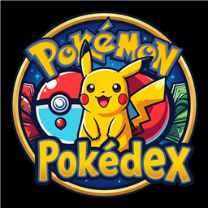
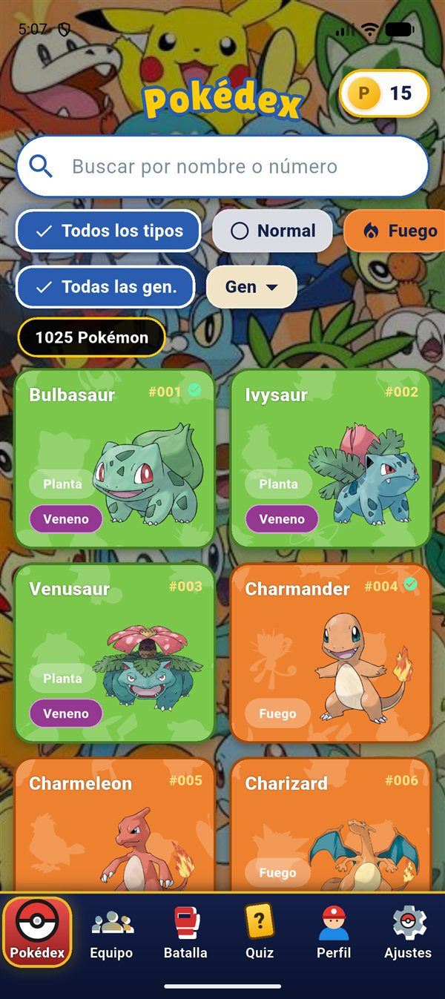
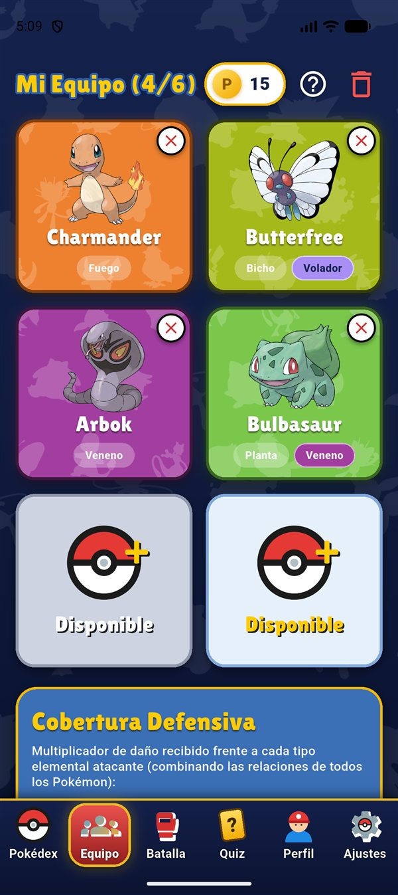
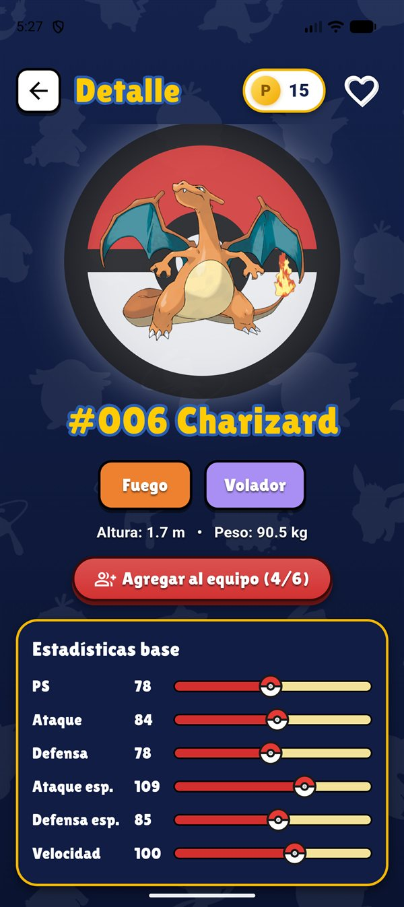
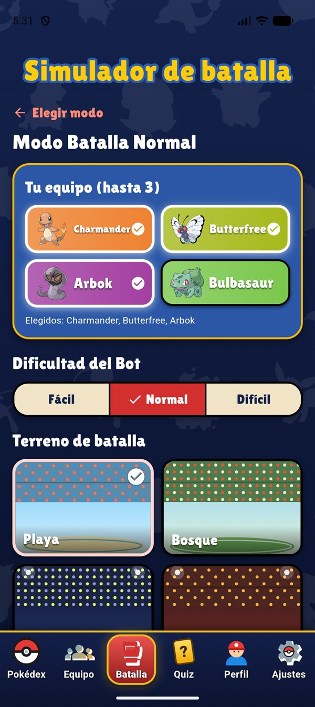
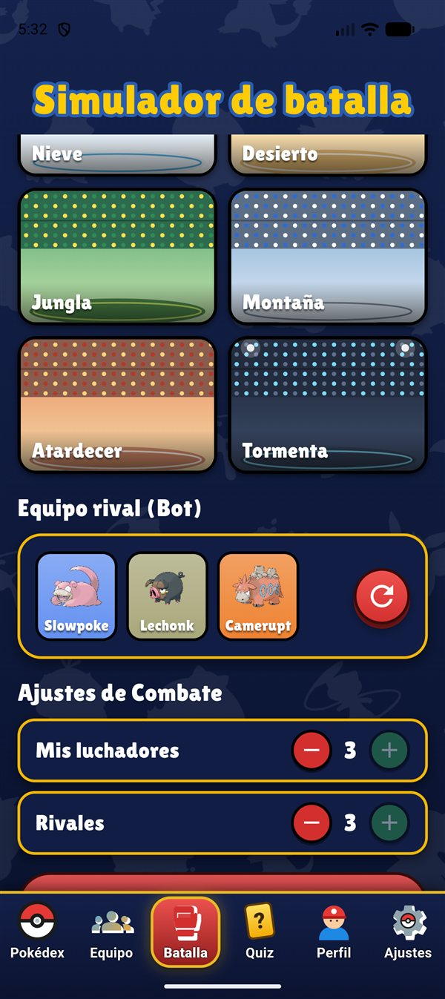

<p align="center">
  
</p>

<h1 align="center">PokéArena</h1>

<p align="center">
  Juego móvil de Pokémon hecho con Flutter: Pokédex completa, equipos, tres modos de batalla,<br>
  duelo en línea, quiz, monedero, música y narrador por voz.
</p>

<p align="center">
  
  
  
  
</p>

---

## ¿Qué es PokéArena?

PokéArena es un proyecto académico (CIPA DevOps) que reúne en una sola app
los módulos clásicos de un juego Pokémon:

- **Pokédex 1–1025** con búsqueda, filtros por tipo y generación, detalle con
  estadísticas, cadena evolutiva, ventajas de tipo y gritos.
- **Equipo** de hasta 6 Pokémon con calculadora de cobertura defensiva.
- **Tres modos de batalla**: Normal (vista GBA), 2.5D por hordas y Duelo en
  línea en tiempo real.
- **Quiz** de siluetas con puntajes y ranking.
- **Monedero** con monedas y desbloqueo de avatares.
- **Perfil** con favoritos, avatar, fondos e historial de puntajes.
- **Ajustes** de tema, sonido, música, gritos y voz del narrador.
- **Cuentas locales** para que cada entrenador tenga sus propios datos.

## Capturas

<table>
  <tr>
    <td align="center"><br><b>Pokédex</b></td>
    <td align="center"><br><b>Equipo</b></td>
    <td align="center"><br><b>Modos de batalla</b></td>
  </tr>
  <tr>
    <td align="center"><br><b>Selección de equipo</b></td>
    <td align="center"><br><b>Rival y ajustes de combate</b></td>
    <td align="center"><i>Próximamente: GBA, 2.5D,<br>Duelo, Quiz y Ajustes</i></td>
  </tr>
</table>

## Tecnologías utilizadas

| Capa | Tecnología |
|---|---|
| Lenguaje | **Dart 3.13** |
| Framework | **Flutter 3.13+** (Material 3, Android / iOS / Web / escritorio) |
| Estado | **Provider** (`ChangeNotifier` por módulo) |
| Datos | **PokeAPI** (`https://pokeapi.co/api/v2`) vía `http` |
| Persistencia | **SharedPreferences** (sesión, equipo, favoritos, ajustes y caché JSON) |
| Audio | **audioplayers** (música, efectos y gritos) + **flutter_tts** (narrador) |
| Online | **Firebase Core + Cloud Firestore** (salas y duelo en tiempo real) |
| Pruebas | **flutter_test** + **fake_cloud_firestore** (494 pruebas) |
| Herramientas | `flutter_launcher_icons`, `flutter_native_splash`, `archive` (generador del manual) |

## Cómo ejecutarlo

Requisitos: Flutter SDK 3.13 o superior y Android SDK (o Chrome para web).

```bash
git clone https://github.com/Kevin8a2000/pokearena.git
cd pokearena
flutter pub get
flutter run
```

Para generar un APK:

```bash
flutter build apk --release --split-per-abi
```

> Firebase es opcional: si no hay red o configuración válida, la app funciona
> sin conexión salvo el modo Duelo online. La voz neuronal de Fish Audio es
> opcional y se activa con `--dart-define=FISH_AUDIO_API_KEY=tu_key`.

## Estructura del proyecto

```text
lib/
├── core/
│   ├── models/      # Pokémon, evoluciones, tipos, puntajes
│   ├── services/    # PokeAPI, caché, música, gritos, voz, historial
│   ├── theme/       # colores, tipografía y sistema de diseño
│   └── widgets/     # componentes reutilizables
├── features/
│   ├── auth/        # cuentas locales
│   ├── splash/      # intro y onboarding
│   ├── home/        # barra de navegación
│   ├── pokedex/     # lista y detalle
│   ├── team/        # equipo y cobertura
│   ├── battle/      # motor de combate, GBA, 2.5D y efectos
│   ├── online/      # salas de Firestore
│   ├── duel/        # duelo en tiempo real
│   ├── quiz/        # quiz de siluetas
│   ├── wallet/      # monedas y desbloqueos
│   ├── profile/     # favoritos, avatares, tema y voz
│   └── settings/    # sonido, legal y tutorial
└── main.dart        # providers, tema y AuthGate
```

## Estado del proyecto

| Sprint | Entrega | Estado |
|---|---|---|
| 0 | Setup, arquitectura y Pokédex mínima | ✅ |
| 1 | Pokédex completa (1–1025) | ✅ |
| 2 | Equipo, favoritos y perfil | ✅ |
| 3 | Batalla por turnos y Quiz | ✅ |
| 4 | Monedero y rediseño visual | ✅ |
| 5 | Modo GBA + tutorial interactivo | ✅ |
| 6 | Modo 2.5D por hordas | ✅ |
| 7 | Cuentas de usuario + Duelo online | ✅ |
| 8 | Música, gritos y voces narradas | ✅ |

El detalle de cada sprint, sus decisiones y retrospectivas está en
[`docs/Documentacion_Sprints_PokeArena.md`](docs/Documentacion_Sprints_PokeArena.md).

## Calidad

```bash
flutter analyze   # 0 issues
flutter test      # 494 pruebas en verde
```

## Créditos y licencias

- **Datos, sprites y gritos:** [PokeAPI](https://pokeapi.co/) — uso fan/educativo.
- **Fondos 2.5D:** pack CC0 de *Nidhoggn* y *Pixel Art Fantasy Game Battlegrounds*
  de CraftPix.net (OGA-BY 3.0).
- **Rips de FireRed/LeafGreen y Platinum:** créditos dentro de las propias
  imágenes; uso exclusivamente educativo, no comercial.
- **Tipografía:** Lilita One (SIL OFL 1.1), licencia incluida en `assets/fonts/`.
- **Pokémon** es una marca de Nintendo / Game Freak / The Pokémon Company.
  Este proyecto no tiene fines comerciales ni se distribuye en tiendas.

---

Proyecto académico — **CIPA DevOps**, 2026.
