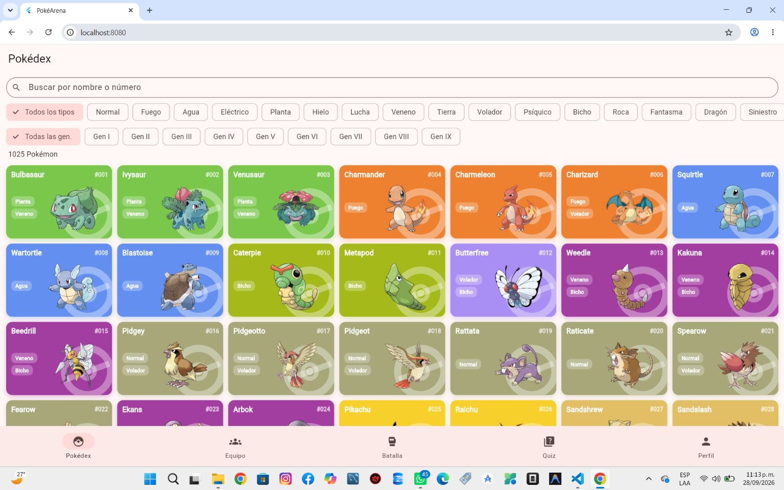
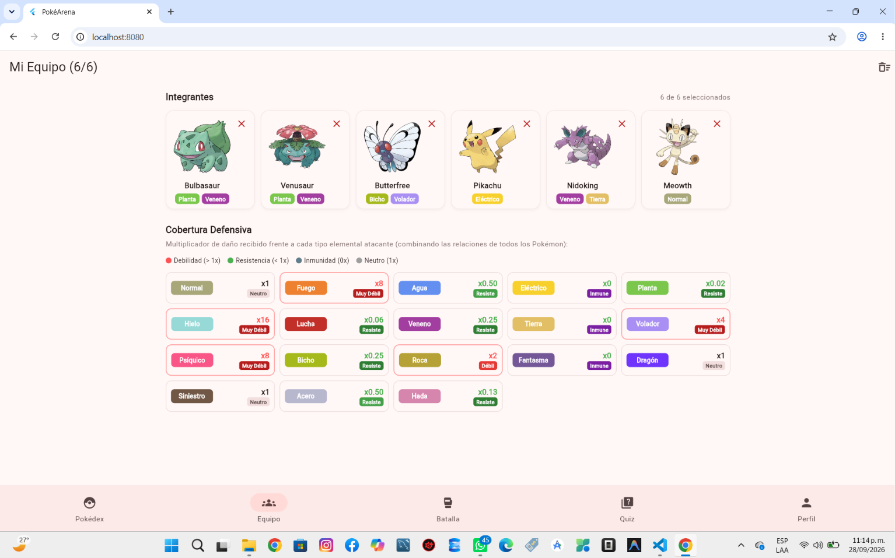
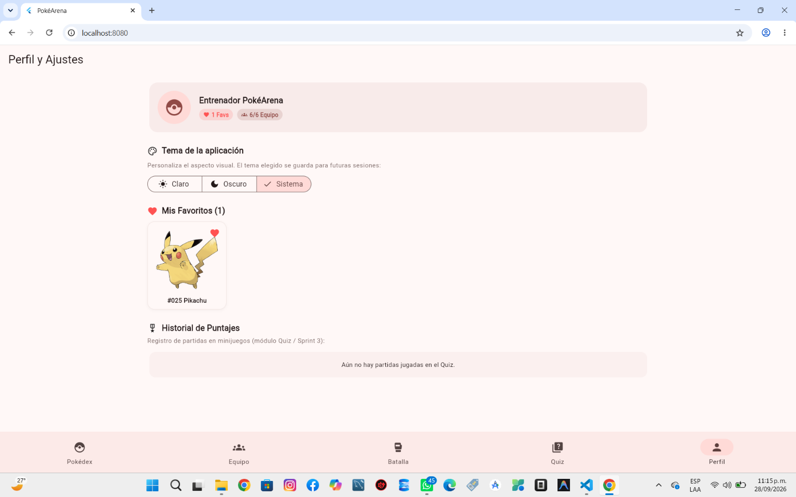

# Documentación Scrum — PokéArena (CIPA DevOps)

## Sprint 0 — Setup del proyecto
**Duración planeada:** 26–28 sept 2026
**Repositorio:** github.com/Kevin8a2000/pokearena — rama `main`

### 1. Sprint Goal (objetivo del sprint)

Dejar listo el entorno de desarrollo, la arquitectura del proyecto y una primera versión mínima de la Pokédex, para que el equipo pudiera empezar a trabajar en paralelo desde el Sprint 1.

### 2. Tareas trabajadas

| ID | Tarea | Estado |
|----|-------|--------|
| S0-1 | Configurar el entorno: Flutter SDK, VS Code + extensión Flutter | ✅ Hecho |
| S0-2 | Crear el proyecto base `pokearena` (`flutter create`) | ✅ Hecho |
| S0-3 | Definir arquitectura por *features* (`core/` + `features/`) | ✅ Hecho |
| S0-4 | Crear `PokeApiService` y los modelos base (`PokemonSummary`, `PokemonDetail`) | ✅ Hecho |
| S0-5 | Construir la Pokédex mínima: lista con scroll y detalle con stats | ✅ Hecho |
| S0-6 | Navegación con 5 pestañas (una por módulo) y tema claro/oscuro | ✅ Hecho |
| S0-7 | Crear el repositorio en GitHub y subir el proyecto | ✅ Hecho |
| S0-8 | Crear el backlog completo del proyecto (sprints 1 a 4) | ✅ Hecho |

### 3. Incremento entregado (qué se podía mostrar al cierre del sprint)

Una app Flutter que corre en Chrome, con una Pokédex funcional (lista de Pokémon con su imagen oficial, detalle con tipos y estadísticas) y una barra de navegación con las 5 secciones planeadas (Pokédex, Equipo, Batalla, Quiz, Perfil), aunque solo la primera tenía contenido real.

### 4. Decisiones técnicas y su justificación

1. **Flutter como framework**, aunque el profesor luego aclaró que el entorno era libre. Se decidió continuar con Flutter porque ya se había configurado el entorno y probado que funcionaba, y porque permite compilar para Android y Web desde una sola base de código, útil para la demo en el stand.
2. **Se descartó usar un repositorio público de terceros como base** (se evaluó un proyecto de Pokédex existente en GitHub). Se decidió construir un proyecto propio desde cero por dos razones: riesgo de integridad académica al presentar código ajeno como propio, y porque ese proyecto no incluía los módulos planeados (equipo, batalla, quiz), que son el diferenciador de PokéArena.
3. **Arquitectura por features desde el inicio**, con una carpeta `core/` para lo compartido (modelos, servicio de API, colores de tipo). Esto permite que los 5 integrantes trabajen en paralelo sobre sus propios módulos sin pisarse entre sí.
4. **Provider como gestor de estado**, por ser más simple de explicar en la sustentación que alternativas como Bloc o Riverpod.

### 5. Dificultades encontradas

- Errores de compatibilidad al intentar correr un proyecto de terceros (paquetes desactualizados frente a la versión reciente de Flutter), lo que confirmó la decisión de construir un proyecto propio.
- Confusión inicial ubicando las carpetas correctas al copiar código entre proyectos en Windows (rutas duplicadas al descomprimir), resuelta verificando siempre el contenido con `dir` antes de copiar.

### 6. Retrospectiva

| Qué funcionó bien | Qué mejorar | Acuerdo para el próximo sprint |
|---|---|---|
| Probar el entorno (`flutter doctor`) antes de escribir código evitó sorpresas grandes más adelante. | Se perdió tiempo evaluando un repositorio de terceros antes de decidir construir uno propio. | Antes de reutilizar cualquier código externo, evaluar primero si calza con los requisitos propios del proyecto. |
| Definir la arquitectura por módulos desde el día 1 facilitó el reparto de trabajo. | Aún no se habían asignado los módulos a cada integrante del CIPA al cierre del sprint. | Asignar módulos y roles (Product Owner, Scrum Master) al iniciar el Sprint 1. |

### 7. Evidencia para la sustentación

- Captura de `flutter doctor` con el entorno correctamente configurado.
- Primer commit del repositorio (`Sprint 0: base del proyecto con Pokedex funcional`).
- Captura de la app corriendo en Chrome con la Pokédex mínima y las 5 pestañas.

---

## Sprint 1 — Pokédex completa
**Duración planeada:** 29 sept – 5 oct 2026
**Repositorio:** github.com/Kevin8a2000/pokearena — rama `feature/pokedex`

---

### 1. Sprint Goal (objetivo del sprint)

Completar el módulo Pokédex: búsqueda, filtros por tipo y generación, detalle ampliado con habilidades y cadena evolutiva, y caché local para uso sin conexión.

### 2. Historias de usuario trabajadas

| ID | Historia de usuario | Estado |
|----|----------------------|--------|
| P1 | Como usuario, quiero buscar un Pokémon por nombre o número para encontrarlo rápido. | ✅ Hecho |
| P2 | Como usuario, quiero filtrar por tipo para ver solo los Pokémon que me interesan. | ✅ Hecho |
| P3 | Como usuario, quiero filtrar por generación para explorar por juego/época. | ✅ Hecho |
| P4 | Como usuario, quiero ver las habilidades de un Pokémon en su detalle. | ✅ Hecho |
| P5 | Como usuario, quiero ver la cadena evolutiva de un Pokémon y navegar entre sus etapas. | ✅ Hecho |
| P6 | Como usuario, quiero que lo que ya vi siga disponible sin conexión a internet. | ✅ Hecho |
| P7 | Como usuario, quiero saber si algo falló y poder reintentar, o ver un mensaje claro si no hay resultados. | ✅ Hecho |
| P8 | Como equipo, queremos pruebas automáticas que confirmen que el modelo de datos y los filtros funcionan bien. | ✅ Hecho (12 pruebas) |

### 3. Incremento entregado (qué se puede mostrar hoy)

- Pokédex con los 1025 Pokémon, cuadrícula con imagen oficial.
- Búsqueda por nombre o número, con espera de 400 ms para no recalcular con cada tecla.
- Filtro por los 18 tipos y por las 9 generaciones, combinables entre sí y con la búsqueda.
- Pantalla de detalle: tipos, altura, peso, habilidades (marcando la oculta) y barras de estadísticas.
- Cadena evolutiva navegable, incluyendo casos ramificados (ej. Eevee).
- Caché local: lo ya visitado se puede volver a abrir sin conexión.
- Manejo de estados: cargando, error con botón "Reintentar", y "sin resultados" con botón "Limpiar filtros".

### 4. Decisiones técnicas y su justificación

*(Para poder explicarlas si el profesor pregunta)*

1. **Carga completa en vez de scroll infinito por páginas.** Se pide una sola vez la lista de los 1025 Pokémon (solo nombres e ids, es liviana) y se filtra en memoria. Esto permite que la búsqueda y los filtros trabajen sobre toda la Pokédex y se combinen entre sí, algo que no sería posible si solo se tuvieran cargados los primeros 30.
2. **Caché "primero disco, luego red".** Como los datos de PokeAPI casi no cambian, se consulta primero el almacenamiento local y solo se llama a la API si no está guardado. Esto acelera la app en visitas repetidas y permite uso parcial sin conexión.
3. **Todas las llamadas HTTP centralizadas en `PokeApiService`.** Ningún widget llama directamente a la API; esto facilita mantenimiento y pruebas.

### 5. Pendiente / conocido

- Se observaron líneas de repintado en la cuadrícula durante el scroll en la versión web de Chrome (cosmético, no afecta la lógica). Pendiente de revisar antes de la sustentación; se probará también en el APK de Android.
- No se llegó a probar exhaustivamente sin conexión (validación rápida hecha, pendiente prueba formal).

### 6. Retrospectiva

| Qué funcionó bien | Qué mejorar | Acuerdo para el próximo sprint |
|---|---|---|
| Definir la arquitectura (core/ + features/) desde el Sprint 0 evitó retrabajo. | La instalación inicial del entorno (Flutter, extensión, copiar carpetas) tomó más tiempo del esperado. | Documentar el paso a paso de instalación una sola vez, para que el resto del equipo no repita los mismos tropiezos. |
| Usar un asistente de IA con instrucciones claras (reglas + tareas numeradas) permitió avanzar rápido en un módulo completo. | Los demás módulos (Equipo, Batalla, Quiz, Perfil) no han iniciado. | Definir en el próximo Daily quién toma cada módulo y fijar fecha de arranque. |

### 7. Evidencia para la sustentación

- Capturas de la Pokédex funcionando: búsqueda, filtros combinados, detalle y evolución (adjuntas en este documento o en el repositorio, carpeta `docs/capturas/`).
- Historial de commits en la rama `feature/pokedex` como evidencia de avance incremental.
- Este documento como acta de Sprint Review + Retrospectiva.

---

## Sprint 2 — Equipo y Perfil
**Duración planeada:** 6–12 oct 2026
**Estado:** En curso — rama `feature/equipo` (commit `f077356`, con cambios aún sin commitear)
**Repositorio:** github.com/Kevin8a2000/pokearena — rama `feature/equipo`

---

### 1. Sprint Goal (objetivo del sprint)

Completar los módulos Equipo y Perfil: equipo de hasta 6 Pokémon con persistencia y análisis de cobertura defensiva, favoritos con persistencia, selector de tema claro/oscuro/sistema, e historial de puntajes como base para el Quiz del Sprint 3.

### 2. Historias de usuario trabajadas

| ID | Historia de usuario | Estado |
|----|----------------------|--------|
| E1 | Como usuario, quiero agregar Pokémon a mi equipo hasta 6 para armar mi formación. | ✅ Hecho |
| E2 | Como usuario, quiero que no se dupliquen Pokémon en mi equipo. | ✅ Hecho |
| E3 | Como usuario, quiero quitar o vaciar mi equipo (con confirmación). | ✅ Hecho |
| E4 | Como usuario, quiero ver la cobertura defensiva combinada ante los 18 tipos (x4, x2, x1, x0.5, x0.25, x0). | ✅ Hecho |
| E5 | Como usuario, quiero ver el desglose por tipo (débiles, resistentes, inmunes) con leyenda de colores. | ✅ Hecho |
| E6 | Como usuario, quiero que mi equipo se guarde y se recupere al reiniciar la app. | ✅ Hecho |
| E7 | Como equipo, queremos pruebas automáticas del cálculo de cobertura. | ✅ Hecho (6 pruebas) |
| F1 | Como usuario, quiero marcar/desmarcar favoritos desde el detalle (corazón). | ✅ Hecho (provider + botón en detalle) |
| F2 | Como usuario, quiero que mis favoritos persistan al reiniciar. | ✅ Hecho |
| F3 | Como usuario, quiero ver mis favoritos en el Perfil y navegar al detalle o quitarlos. | ✅ Hecho |
| F4 | Como usuario, quiero cambiar entre tema Claro / Oscuro / Sistema y que se recuerde. | ✅ Hecho |
| F5 | Como equipo, queremos un historial de puntajes listo para el Quiz (guardar, listar, filtrar, limpiar). | ✅ Hecho (5 pruebas) |

### 3. Incremento entregado (qué se puede mostrar hoy)

- Equipo 0/6 a 6/6 con grilla de slots, estado vacío con guía ("Ve a Pokédex → detalle → Agregar al equipo"), quitar individual y "Vaciar equipo" con diálogo de confirmación.
- Cobertura defensiva en tiempo real: grilla de 18 tipos con píldora de color, multiplicador (`x4`, `x2`, `x1`, `x0.5`, `x0`) y badge (`Muy Débil`, `Débil`, `Resiste`, `Inmune`, `Neutro`) + leyenda. Hover con elevación/glow en web.
- Perfil: tarjeta "Entrenador PokéArena" con contadores (`N Favs`, `N/6 Equipo`), `SegmentedButton` de tema, grilla de favoritos con hover/animación y navegación al detalle, e historial de puntajes (vacío: "Aún no hay partidas jugadas en el Quiz").
- Persistencia con `SharedPreferences`: `pokearena_team_ids`, `pokearena_favorite_ids`, `pokearena_theme_mode`, `pokearena_score_history`.
- `flutter test`: **29/29 en verde** (13 previas + 16 nuevas: 6 cobertura + 5 perfil/favoritos/tema + 5 historial).

### 4. Decisiones técnicas y su justificación

*(Para poder explicarlas si el profesor pregunta)*

1. **Cálculo puro separado en `TeamCoverageCalculator`.** `TeamProvider` solo orquesta estado/red/persistencia; la matemática (`calculateCombinedMultipliers`, `calculateDetailedCoverage`, `calculatePokemonMultiplier`) es estática y testeable sin Flutter ni red. Regla: dual defensivo multiplica (ej. Agua/Tierra ante Planta `2.0*2.0=4.0`); equipo multiplica miembros (ej. dos Fuego ante Agua `2.0*2.0=4.0`); inmunidad `x0` anula el producto.
2. **`SharedPreferences` directo para datos de usuario, `LocalCache` solo para caché HTTP.** El equipo/favoritos/tema/historial son estado persistente con claves propias (`pokearena_team_ids`, etc.), mientras `LocalCache` usa prefijo `pokearena_cache_` para respuestas de PokeAPI. Documentado en `team_provider.dart:132-136`.
3. **Relaciones de tipo con caché en memoria + `Future.wait` en paralelo.** Se extraen los tipos únicos del equipo, se consulta `/type/{name}` solo si falta en `_relationsCache` y en paralelo. Si falla la red, se conserva el último cálculo.
4. **Favoritos resueltos vía lista completa cacheada.** `loadFavorites` lee ids y resuelve nombres con `fetchAllPokemon()` (ya cacheado disco-primero); sin red cae a `Pokémon #id` para no bloquear la UI.
5. **Tema global con `Consumer<ThemeProvider>` en `main.dart`.** `MaterialApp.theme/darkTheme` fijos con `seedColor: redAccent` y `themeMode` reactivo; carga inicial con `loadSavedTheme()`.
6. **Historial como servicio inyectable (`ScoreHistoryService([prefs])`).** Guarda JSON ordenado reciente-primero, con filtro por `gameName`, pensado para el Quiz del Sprint 3 sin acoplarlo a UI.

### 5. Pendiente / conocido

- Rama `feature/equipo` aún sin merge a `main`: hay 5 archivos modificados sin commitear (`pokedex_page`, `pokemon_detail_page`, `profile_page`, `team_page`, `main.dart`) + 5 nuevos sin trackear (`score_entry.dart`, `score_history_service.dart`, `favorites_provider.dart`, `theme_provider.dart`, tests de perfil/historial). Falta commit + PR + merge.
- Batalla y Quiz siguen en placeholder ("Módulo en construcción (Sprint 3)").
- Falta captura de evidencia: 2-3 pantallas (Equipo, Perfil, cobertura) en `docs/capturas/` y captura de `flutter test` en verde.
- Validar en APK Android (el hover/glow es solo web/desktop) y prueba formal sin conexión del equipo/favoritos guardados.

### 6. Retrospectiva

| Qué funcionó bien | Qué mejorar | Acuerdo para el próximo sprint |
|---|---|---|
| Separar cálculo puro de provider permitió 6 pruebas de cobertura sin mocks de red. | Se acumuló mucho cambio sin commitear en `feature/equipo` (1237 inserciones). | Commitear por módulo (Equipo / Perfil / Historial) y no dejar todo al cierre. |
| Reutilizar caché disco-primero de PokeAPI aceleró favoritos y cobertura. | Faltó definir backlog con IDs E1-E7/F1-F5 antes de codificar (se infirieron del código/tests). | Crear `Backlog_Scrum_PokeArena.md` antes del Sprint 3. |
| Servicio de historial desacoplado deja el Quiz desbloqueado. | Sin capturas ni PR aún, la evidencia de sustentación está incompleta. | Al cerrar Sprint 2: capturas + `flutter test` + PR a `main`. |

### 7. Evidencia para la sustentación

- Commit `f077356 feat(team)` + `d6c329d Sprint 2` + `3c8add5 fix(pokedex tarjeta referencia)` + merge `f89754e` a `main`.
- `flutter test`: `All tests passed!` — 29 pruebas (ver `test/team_coverage_test.dart`, `test/profile_providers_test.dart`, `test/score_history_test.dart`).
- Capturas Sprint 2 en `docs/capturas/`:
  - Pokédex con tarjeta referencia: 
  - Equipo 6/6 + cobertura defensiva: 
  - Perfil con favoritos + tema + historial: 
- Este documento como acta de Sprint Review + Retrospectiva.

---

## Sprint 3 — Batalla y Quiz
**Duración planeada:** 13–19 oct 2026
**Repositorio:** github.com/Kevin8a2000/pokearena — rama `feature/sprint3-batalla-quiz`

---

### 1. Sprint Goal (objetivo del sprint)

Sacar del placeholder los dos módulos que faltaban (Batalla y Quiz):
un simulador de batalla por turnos 1 contra 1 contra un rival salvaje
aleatorio, con estadísticas y efectividad de tipo reales, y un Quiz de
"adivina el Pokémon" por silueta con ranking y guardado en el historial
creado en el Sprint 2.

### 2. Historias de usuario trabajadas

| ID | Historia de usuario | Estado |
|----|----------------------|--------|
| B1 | Como usuario, quiero elegir un Pokémon de mi equipo (o uno inicial si aún no tengo equipo) para enfrentar a un rival salvaje aleatorio. | ✅ Hecho |
| B2 | Como usuario, quiero que el daño se calcule con las estadísticas reales y la efectividad de tipo (x2/x1/x0.5/x0). | ✅ Hecho |
| B3 | Como usuario, quiero ver golpes críticos y una arena animada, no solo texto. | ✅ Hecho |
| B4 | Como usuario, quiero que el rival también use sus propios poderes según su tipo, no solo ataques genéricos. | ✅ Hecho |
| B5 | Como usuario, quiero un KO dramático y no que el combate corte en seco al ganar o perder. | ✅ Hecho |
| B6 | Como equipo, queremos pruebas automáticas de la calculadora de daño/efectividad. | ✅ Hecho (varias pruebas en `battle_calculator_test.dart`) |
| Q1 | Como usuario, quiero adivinar el Pokémon por su silueta antes de que se revele. | ✅ Hecho |
| Q2 | Como usuario, quiero jugar 10 rondas con tiempo límite por ronda. | ✅ Hecho |
| Q3 | Como usuario, quiero ver mi puntaje final y que quede guardado en mi historial (del Sprint 2). | ✅ Hecho |
| Q4 | Como equipo, queremos pruebas automáticas del generador de opciones y del puntaje. | ✅ Hecho (`quiz_provider_test.dart`) |

### 3. Incremento entregado (qué se puede mostrar hoy)

- Batalla: se elige un Pokémon del equipo para enfrentar a un rival
  salvaje aleatorio, combate 1 contra 1 por turnos con daño calculado
  desde estadísticas base + efectividad de tipo, golpes críticos,
  proyectiles por el tipo del poder usado (propio y del rival) y una
  pantalla de KO antes de cerrar el combate.
- Quiz: silueta que se revela al acertar o agotar el tiempo, 10 rondas,
  temporizador por ronda, ranking local y la partida queda guardada en
  el historial ya construido en el Sprint 2 (`ScoreHistoryService`).
- `flutter test`: **37/37 en verde** (29 del Sprint 2 + 8 nuevas de
  `battle_calculator_test.dart`/`quiz_provider_test.dart`).

### 4. Decisiones técnicas y su justificación

1. **Cálculo de daño/efectividad separado en `battle_calculator.dart`**,
   igual patrón que `TeamCoverageCalculator` del Sprint 2: función pura,
   testeable sin Flutter ni red, que recibe estadísticas y tipos y
   devuelve daño/efectividad/crítico.
2. **`BattleProvider` orquesta turnos y estado**, dejando toda la
   matemática al calculador; así la UI (`battle_page.dart`) solo
   reacciona a cambios de estado (HP, log de combate, ganador).
3. **Quiz reutiliza `ScoreHistoryService([prefs])`** del Sprint 2 tal
   como se dejó planeado en su retro, sin tener que tocar su código.

### 5. Pendiente / conocido

- Esta acta se escribe al cerrar el sprint; el merge a `main` se hizo
  en el mismo momento (ver evidencia).
- Quedan fuera de este sprint (ya en marcha para los siguientes):
  rediseño visual completo + sistema de monedas, un modo de batalla
  estilo consola GBA con tutorial interactivo, un modo de batalla 2.5D
  por hordas, Duelo en tiempo real con cuentas de usuario, y música/voces
  narradas — cada uno se documentará como su propio sprint.

### 6. Retrospectiva

| Qué funcionó bien | Qué mejorar | Acuerdo para el próximo sprint |
|---|---|---|
| Reusar el patrón de "calculadora pura + provider" del Sprint 2 (cobertura de tipos) aceleró mucho el cálculo de daño y sus pruebas. | Varias mejoras de batalla (arena animada, críticos, poderes del rival, KO) se hicieron en commits sueltos después del commit "Sprint 3" inicial, en vez de agruparlas antes de avisar que el sprint estaba listo. | Cerrar cada commit grande con su propio `flutter test` en verde antes de seguir con el siguiente, para no acumular cambios sin cerrar. |
| Reutilizar `ScoreHistoryService` del Sprint 2 sin modificarlo confirmó que separar esa lógica de la UI fue buena decisión. | Seguía sin existir `Backlog_Scrum_PokeArena.md` (pendiente desde el Sprint 2); los IDs B1-B6/Q1-Q4 de esta acta se infirieron del código y los tests. | Crear el backlog formal antes de seguir repartiendo trabajo en más sprints. |

### 7. Evidencia para la sustentación

- Commits en `feature/sprint3-batalla-quiz`: `4860acd feat(quiz)` →
  `f1533d9 feat(battle)` → `a70dad7 feat(battle)` → `1042fa3 fix(battle)`
  → `1c34ec8 feat(battle)`, mergeados a `main` con merge commit "Merge
  Sprint 3: simulador de batalla por turnos + Quiz".
- `flutter test`: `All tests passed!` — 37 pruebas.
- Este documento como acta de Sprint Review + Retrospectiva.

---

## Sprint 4 — Economía y diseño visual
**Duración planeada:** 20–26 oct 2026
**Repositorio:** github.com/Kevin8a2000/pokearena — rama `feature/sprint4-economia-diseno`

---

### 1. Sprint Goal (objetivo del sprint)

Antes de seguir agregando modos de batalla, se necesitaba una base común:
un sistema de monedas (ganar jugando, gastar para desbloquear Pokémon) y
un rediseño visual consistente ("colores Pokémon": marino + dorado) en
las pantallas que ya existían, para que todo lo que se construya después
se sienta parte de la misma app.

### 2. Historias de usuario trabajadas

| ID | Historia de usuario | Estado |
|----|----------------------|--------|
| W1 | Como usuario, quiero ganar monedas al vencer en Batalla. | ✅ Hecho |
| W2 | Como usuario, quiero que los primeros 30 Pokémon de la Pokédex sean gratis y el resto se desbloquee con monedas según su generación. | ✅ Hecho |
| W3 | Como usuario, quiero ver cuántas monedas tengo desde cualquier pantalla (Pokédex, Equipo, Batalla, Perfil). | ✅ Hecho |
| D1 | Como usuario, quiero una Pokédex, Equipo, Perfil, Quiz y Ajustes con una identidad visual propia, no la plantilla de Material por defecto. | ✅ Hecho |
| D2 | Como usuario, quiero una barra de navegación inferior con iconos ilustrados en vez de la genérica. | ✅ Hecho |
| D3 | Como usuario, quiero elegir mi foto de perfil entre cualquiera de los 1025 Pokémon. | ✅ Hecho |
| D4 | Como usuario, quiero una pantalla de bienvenida (splash) con el logo e identidad de la app, no la pantalla en blanco por defecto. | ✅ Hecho |
| D5 | Como equipo, queremos un ícono y splash nativos propios (no el de Flutter) en Android/iOS/Web. | ✅ Hecho |

### 3. Incremento entregado (qué se puede mostrar hoy)

- Monedero (`WalletProvider`): se gana al ganar una batalla clásica, se
  gasta para desbloquear Pokémon más allá de los primeros 30 (precio
  según su generación), con un chip dorado visible en Pokédex, Detalle,
  Equipo y Batalla.
- Rediseño completo con el mismo lenguaje visual (fondo marino con
  Pokébolas, paneles con borde dorado, tipografía "Lilita One") en
  Pokédex, Equipo, Perfil, Quiz y la nueva pantalla de Ajustes.
- Barra de navegación inferior propia con 6 destinos ilustrados
  (Pokédex, Equipo, Batalla, Quiz, Perfil, Ajustes).
- Selector de foto de perfil ampliado a los 1025 Pokémon (antes 12 fijos).
- Secuencia de bienvenida con 3 pantallas + precarga de la Pokédex, e
  íconos/splash nativos generados con `flutter_launcher_icons` /
  `flutter_native_splash`.
- `flutter test`: **82/82 en verde**.

### 4. Decisiones técnicas y su justificación

1. **`WalletProvider` desacoplado de `BattleProvider`.** La recompensa se
   conecta desde la pantalla (`BattlePage` asigna `battle.onWin`) en vez
   de que `BattleProvider` importe `WalletProvider` directamente —
   mantiene el simulador de batalla testeable sin depender de la
   economía.
2. **Reglas de precio/desbloqueo puras en `WalletRules`**, mismo patrón
   que `TeamCoverageCalculator`/`battle_calculator.dart`: funciones
   estáticas sin estado, fáciles de probar.
3. **Un solo sistema de diseño (`poke_design.dart` + `core/widgets/`)**
   reutilizado por las 5 pantallas rediseñadas, en vez de repetir estilos
   sueltos en cada una.
4. **Splash con precarga real**, no solo decorativa: mientras se ven las
   3 imágenes de bienvenida se van pidiendo los artworks de la Pokédex,
   así la app ya tiene caché al entrar.

### 5. Pendiente / conocido

- El propio módulo de Batalla (`battle_page.dart`) solo recibió el chip
  de monedas; su rediseño visual completo llega en el Sprint 5 junto con
  el nuevo modo de combate GBA.
- Quedan pendientes para sprints siguientes: modo de batalla GBA con
  tutorial (Sprint 5), modo 2.5D por hordas (Sprint 6), cuentas de
  usuario + Duelo en tiempo real (Sprint 7) y audio/voces narradas
  (Sprint 8).

### 6. Retrospectiva

| Qué funcionó bien | Qué mejorar | Acuerdo para el próximo sprint |
|---|---|---|
| Separar `WalletRules` del provider permitió probar precios y reglas sin necesidad de `BattleProvider` ni red. | El sistema de sonido (`SoundService`) se adelantó a este sprint porque varias pantallas ya lo llamaban; conviene dejarlo explícito en el Sprint Goal la próxima vez en lugar de que aparezca "de paso". | Si una pieza de infraestructura (como el sonido) se nota necesaria a mitad de sprint, anotarla en el backlog del sprint en curso en vez de dejarla implícita. |
| Rediseñar 5 pantallas con el mismo sistema (`poke_design.dart`) a la vez evitó inconsistencias entre ellas. | El selector de avatar ampliado a 1025 Pokémon depende de que la Pokédex ya haya cargado para buscar por nombre; sin conexión solo se puede buscar por número. | Documentar esa limitación en la ayuda del propio selector. |

### 7. Evidencia para la sustentación

- Commit `feat(wallet): sistema de monedas + rediseño visual` en
  `feature/sprint4-economia-diseno`, mergeado a `main`.
- `flutter test`: `All tests passed!` — 82 pruebas.
- Este documento como acta de Sprint Review + Retrospectiva.

---

## Sprint 5 — Modo de batalla GBA + tutorial interactivo
**Duración planeada:** 27 oct – 2 nov 2026
**Repositorio:** github.com/Kevin8a2000/pokearena — rama `feature/sprint5-gba-tutorial`

---

### 1. Sprint Goal (objetivo del sprint)

Llevar la Batalla de un duelo 1 contra 1 a un combate completo estilo
videojuego Pokémon: equipos de hasta 3, cambios, pociones, un movimiento
especial cargable, una consola GBA retro como vista principal, y un
tutorial interactivo que resalta los botones reales en vez de solo texto.

### 2. Historias de usuario trabajadas

| ID | Historia de usuario | Estado |
|----|----------------------|--------|
| G1 | Como usuario, quiero armar un equipo de hasta 3 Pokémon (no solo 1) para la batalla. | ✅ Hecho |
| G2 | Como usuario, quiero cambiar de Pokémon durante el combate si el rival me gana en tipo. | ✅ Hecho |
| G3 | Como usuario, quiero usar una poción limitada para curarme a costa de mi turno. | ✅ Hecho |
| G4 | Como usuario, quiero cargar un Movimiento Z peleando y soltarlo cuando esté listo. | ✅ Hecho |
| G5 | Como usuario, quiero elegir la dificultad del Bot (fácil/normal/difícil) y el terreno de la batalla. | ✅ Hecho |
| G6 | Como usuario, quiero una vista estilo consola GBA (pantalla + mando) en vez de la vista de tarjetas simple. | ✅ Hecho |
| G7 | Como usuario, quiero un tutorial que resalte cada botón real de combate (no un ejemplo aparte) la primera vez que juego. | ✅ Hecho |
| G8 | Como usuario, quiero que mi Pokémon y el rival suenen al entrar y que un comentarista narre los golpes importantes. | ✅ Hecho |
| G9 | Como equipo, queremos pruebas automáticas de la orientación forzada, el terreno y el tutorial. | ✅ Hecho |

### 3. Incremento entregado (qué se puede mostrar hoy)

- Selección de hasta 3 Pokémon de tu equipo, dificultad del Bot (con su
  propia tasa de crítico e IA), 10 terrenos GBA pintados por código y
  tamaño de equipo 1v1/2v2/3v3 por lado.
- Combate con PP por ataque, poción limitada, cambio de Pokémon (cede el
  turno), carga de Movimiento Z al pelear y entrada animada con los dos
  entrenadores lanzando sus Poké Balls.
- Vista de consola GBA: pantalla con el combate + mando con cruceta y
  botones A/B/START/SELECT, también jugable por toques directos.
- Tutorial con foco de luz: resalta uno a la vez los botones reales
  (LUCHAR/MOCHILA/POKÉMON/HUIR) y lo que abren (ataques, poción, equipo),
  oscureciendo y bloqueando el resto, más las 4 láminas previas que
  explican las reglas generales.
- Gritos de los Pokémon al entrar y comentarista de combate (texto +
  narración por voz) en los golpes críticos, fallos y súper-efectivos.
- `flutter test`: **180/180 en verde**.

### 4. Decisiones técnicas y su justificación

1. **El motor de equipos (PP/pociones/Movimiento Z/dificultad) vive en el
   mismo `BattleProvider`** que ya existía, no en uno aparte: la vista
   GBA es una "piel" sobre el mismo estado, lo que permitirá que un futuro
   modo (2.5D) reutilice exactamente la misma lógica de combate sin
   duplicarla.
2. **Tutorial con `GlobalKey` sobre los widgets reales** (`gba_action_
   spotlight.dart`) en vez de capturas de pantalla o ejemplos de mentira:
   el foco de luz mide la posición exacta del botón real en pantalla, así
   nunca se desincroniza del diseño.
3. **Comentarista y gritos aislados en sus propios servicios**
   (`battle_commentary.dart`, `cry_service.dart`, `narrator_service.dart`)
   con banderas para apagarlos (`battleCriesEnabled`, `voiceEnabled`):
   quedan listos para que Ajustes los exponga más adelante.
4. **Orientación horizontal forzada con contador de referencias**
   (`BattleOrientation`), no un booleano simple, para que si más de un
   consumidor la pide (por ejemplo, un futuro combate online) no se
   restaure la vertical hasta que todos la suelten.

### 5. Pendiente / conocido

- El modo "2.5D" (varios rivales a la vez) y el selector de modo de
  batalla (Normal/2.5D/Online) llegan en el Sprint 6, reutilizando este
  mismo motor de combate.
- El comentarista narrado y los gritos no tienen todavía un control de
  voz/volumen propio en Ajustes (día a día siguen con sus valores por
  defecto); eso se termina de exponer en el Sprint 8 (Audio).

### 6. Retrospectiva

| Qué funcionó bien | Qué mejorar | Acuerdo para el próximo sprint |
|---|---|---|
| Diseñar el tutorial para medir botones reales (`GlobalKey`) en vez de maquetar pantallas de ejemplo ahorró mantenerlo sincronizado a mano. | El `BattleProvider` creció mucho en un solo sprint (equipos, PP, pociones, Z, terreno, comentarista); para el Sprint 6 conviene no sumarle más responsabilidades nuevas, solo el modo 2.5D reutilizando lo ya construido. | Si el Sprint 6 necesita algo que hoy no existe en el motor, evaluar primero si de verdad es exclusivo de 2.5D o si en realidad lo necesitan ambos modos. |
| Separar gritos/comentarista en servicios propios con su propia bandera on/off evitó acoplar el audio al resto del combate. | Falta control de voz/volumen visible para el usuario (llega en Sprint 8). | Documentar esa dependencia en el Sprint Goal del Sprint 8 para no olvidarla. |

### 7. Evidencia para la sustentación

- Commit `feat(battle): modo GBA con combate por equipos, tutorial interactivo, comentarista y gritos` en `feature/sprint5-gba-tutorial`, mergeado a `main`.
- `flutter test`: `All tests passed!` — 180 pruebas.
- Este documento como acta de Sprint Review + Retrospectiva.

---

## Cómo seguir documentando (guía para ti)

No necesitas saber Scrum de memoria para esto. Cada vez que cierres un sprint, solo responde estas preguntas y las paso a este mismo formato:

1. **¿Qué tareas del backlog se completaron y cuáles no?** (copia la lista del archivo `Backlog_Scrum_PokeArena.md`)
2. **¿Qué se puede mostrar hoy en la app?** (2-3 frases)
3. **¿Qué decisiones técnicas tomaste que valga la pena explicar?**
4. **¿Qué no salió bien o quedó pendiente?**
5. **¿Qué aprendieron y qué acuerdan para el siguiente sprint?**

Con esas 5 respuestas (aunque sea en frases sueltas, sin formato), yo te devuelvo el acta ya redactada, como esta. Solo dime "documenta el Sprint X" y te hago las preguntas.

### Qué guardar como evidencia en cada sprint

- 2-3 capturas de pantalla de lo que ya funciona.
- El resultado de `flutter test` (captura de la terminal en verde).
- El link al commit o Pull Request del sprint.

Con esas tres cosas por sprint, al final del proyecto tienes un historial completo y creíble del proceso Scrum, sin haber tenido que llevar un diario constante.
